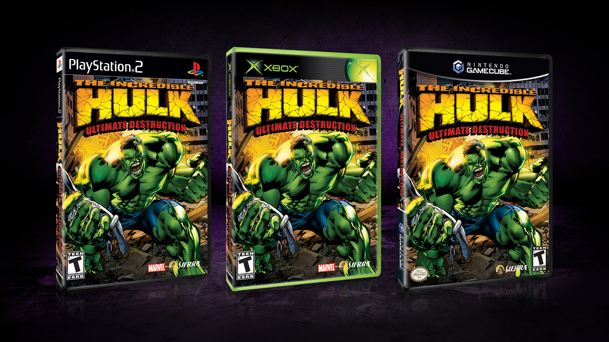
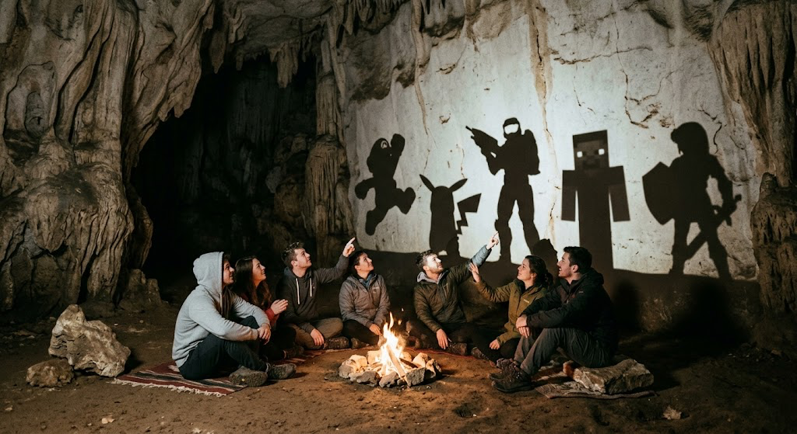

"What would the world look like if everything was open-source" if a common refrain I've heard lately.
Projects like [reverse engineer anything](https://github.com/morluto/rea) that offer AI skills and tools that can turn any shipped binary into actual code.

While I think that is somewhat true and will become even more true overtime, we aren't there yet.

I tried to reverse engineer or decompile a game to prove and he's my take.

There are many others out there such as [this guide about N64 from 2025](https://blog.chrislewis.au/using-coding-agents-to-decompile-nintendo-64-games/) or a [more recent one about a certain first person shooter](https://momo5502.com/posts/2026-10-09-game-decompilation/) that was taken down for copyright reasons.

I will try to add to the discourse rather than echo what has already been said.

## Disclaimer

> This is an unofficial, non-commercial fan project. It is not affiliated with, endorsed by or sponsored by Marvel, The Walt Disney Company, Radical Entertainment, Vivendi Universal Games, Activision or Microsoft. "The Incredible Hulk", "Hulk", "Marvel" and all related names, characters and marks are trademarks of their respective owners and are used here only to identify the game this project is compatible with. The blog post and the repository contains no executables, data or assets from the original release; to use it you need your own legally obtained copy of the game. Nothing here is offered for sale.

## Getting started

The game I started on [Hulk Ultimate Destruction](https://en.wikipedia.org/wiki/The_Incredible_Hulk%3A_Ultimate_Destruction), which was one of my favorites.


You can rip cars in half and use them as boxing gloves.
Punch buildings so hard they fall down.
Fly through the air or clap so hard the world explodes.

I had started a variation of this project a year or two ago.
The rough idea was to hoist the game into a emulator environment (often known as recomp) where it would run as a background process.
Then just render new graphics on top using tracked memory locations to inform the state of all the objects in the game, similar to how they remastered the older Halo games.
This was ultimately scrapped as this is basically writing a brand new game that derives the game logic from a complex black box.

Going into this project, I started with a local qwen 3.8-27B model running on an older macbook and a $20/mo claude plan.
I really thought that local models would be able to do it all, but I was quite wrong.

## How Decomps Work

The basic idea of a decomp is you run a program like [ghidra](https://github.com/NationalSecurityAgency/ghidra) (a decompiling tool from the NSA of all people) that takes in assembly and turns it into very very terrible C.
It tried to identify functions, classes, vtables, and the like.

Xbox games are x86 as they are built for a pentium 3 so you start with assembly like this:

```asm
sub   esp, 0x8
mov   eax, [esp+0xc]
push  ebx
mov   ebx, [esp+0x14]
push  ebp
push  esi
mov   esi, eax
movzx ebp, ah
and   eax, 0xff
mov   [esp+0xc], eax
movzx eax, bh
sub   eax, ebp
push  edi
movzx edi, byte ptr [esp+0x1e]
mov   [esp+0x1c], eax
mov   [esp+0x14], ecx
shr   esi, 0x18
fild  dword ptr [esp+0x1c]
fmul  dword ptr [esp+0x24]
call  __ftol
...
add   eax, esi
...
or    ebp, eax
mov   eax, [esp+0x14]
mov   [eax], ebp 
...
ret   0xc
```
> Note: for particular example, the assembly shown here does not come from the hulk game but is an example that I have made up.

Which ghidra turns into terrible c:

```c
void __thiscall FUN_00011750(uint *param_1,uint param_2)
{
  int iVar1, iVar2, iVar3, iVar4;

  iVar1 = FUN_0034483c();
  iVar2 = FUN_0034483c();
  iVar3 = FUN_0034483c();
  iVar4 = FUN_0034483c();
  *param_1 = (iVar1 + (param_2 >> 0x10 & 0xff)) * 0x10000 | (iVar2 + (param_2 >> 8 & 0xff)) * 0x100
             | (iVar3 + (param_2 >> 0x18)) * 0x1000000 | iVar4 + (param_2 & 0xff);
}
```

The goal is to turn it into something like this:

```c++
struct ColorRGB888 {
 unsigned int value;
 void lerp(unsigned int from, unsigned int to, float amount);
};

void ColorRGB888::lerp(unsigned int from, unsigned int to, float amount) {
 int red = (from >> 16) & 255;
 int green = (from >> 8) & 255;
 int alpha = from >> 24;
 int blue = from & 255;
 unsigned int result = (unsigned int)(red + (int)(((int)((to >> 16) & 255) - red) * (double)amount)) << 16;
 result |= (unsigned int)(green + (int)(((int)((to >> 8) & 255) - green) * (double)amount)) << 8;
 result |= (unsigned int)(alpha + (int)(((int)(to >> 24) - alpha) * (double)amount)) << 24;
 result |= (unsigned int)(blue + (int)(((int)(to & 255) - blue) * (double)amount));
 value = result;
}
```
It's now obvious that this is a color lerp (linear interpolation) for an RGB888 color space.

The goal is to take in the assembly, the c, any context, and spin out C++ we compile and prove that it matches the assembly exactly.

Once you have every function matching exactly, you have a good starting point to rebuild it for other platforms, start making tweaks like skipping cutscenes, rewriting shaders, or adding new missions.

## How AI Does It

The [pi-durable](https://earendil.com/posts/pi-durable/) seemed perfect for this kind of thing where it can spin up resumable conversations to try on each match.
Showing that this is something you can do without an expensive cloud subscription was a goal and so I tried Qwen3.6-35B-A3B. 
The performance of the local model on the macbook was 45 t/s with a fairly terrible match rate.
Switching to Deepseek v4 was much better but it generated a measly 1-4 matches an hour due to the super slow tokens per second (5-6t/s is what my records say but that seems super slow).
But it matched 89% of the time, rather than Qwen's ~30%.
Assuming an average of 2.5/hour that's 457 days straight of running a model.
Based on recent trends, dozens of new better models would come out in that time frame.

Despite my principles, I needed help.

My next step was to put $20 into OpenRouter and have the farm start making cheap matches.
However, when you have 27,477 functions to match, if each one costs on average $0.01 that's $274.
And some of them are 1000s of instructions long, which means it's going to be way more $0.01.

The AI made a decent chunk of progress quickly with GPT-Luna, GLM 5.3 Flash, and Deepseek v4, but the cost was quickly rising to a level I personally was not happy with.
Twenty USD was probably going to be a limit I was happy with.
I have a spouse and a family and justifying "you spent how much on AI to do what" didn't feel like a particularly defensible position.
A friend of mine mentioned paying for tokens directly was probably the least cost effective thing I could do, a subscription is almost always going to be cheaper per token.
So, with an OpenAI subscription and a Anthropic subscription in hand, I was ready.
I plugged it into pi so pi-durable could pick it up.

The upside of using OpenRouter is we had examples with reasoning we could fine-tune a model.
So instead of running a local model on the laptop, I used unsloth to fine-tune Qwen which claude dubbed ulk-1. 

This was a clear improvement but clearly wasn't a winner, only getting to ~45% pass rate.
The latter version ulk-2 added equivalence (more on that later) and data from other x86 decomp projects I found on github, 

## Why Do It?

There are easier ways to play an old game you love.
An old xbox at the retro game store by my house is $50 and a copy of a disk can be had on your favorite auction sites for $5-10 USD.
You can obtain a legal copy of a game iso and play it on an xbox emulator (xemu was used heavily in this project).
There are projects that recompile games like [XenonRecomp](https://github.com/hedge-dev/XenonRecomp) which re-compiles xbox360 games into c++.
They are effectively hoisting the VM into the code itself as it maintains PowerPC CPU state as a variable into functions.
Games still remain an opaque black box.

To quite butcher an old allegory by a Greek guy, imagine the game as being a cave where what you play is just the shadows projected on the wall.



The reality is that we almost never can leave the cave and see what is actually casting the shadows.
These are proprietary projects with IP and copyright and lawyers.
But we can explore the cave and see the hints of what was.

It is awesome to look through games I loved and find a partially complete Lua 5.1 interpreter for missions with a few opcodes missing.
Why did they go for 5.1? It wasn't officially released until 2006 (two years after the game was released).

## Can I Do It?


